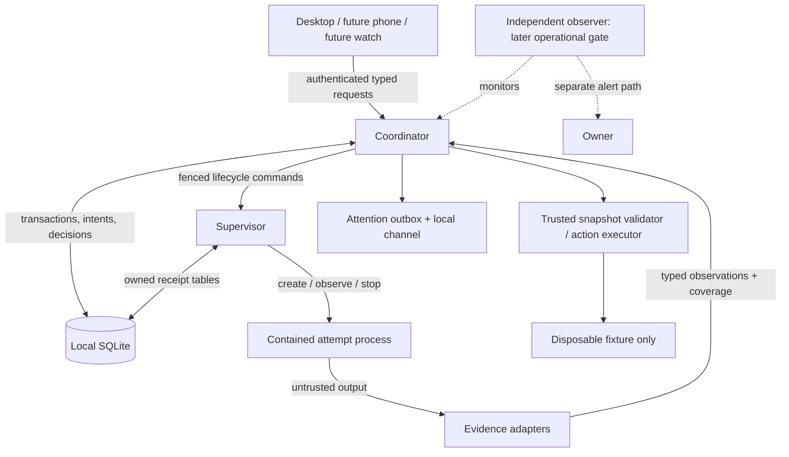

# Architecture recommendation and trust boundaries

## Shape

One repository, two binaries/process roles and an owner CLI are enough. Evidence validation, final-action execution and attention delivery are modules of the coordinator initially. All external subprocesses, including validators, are launched through the supervisor; coordinator modules never bypass it to spawn helpers. The fixture ref executor should use an in-process Git library operation with a native ref lock/compare-and-swap, or a supervised typed helper whose identity is recorded against the effect. A helper still running after coordinator loss keeps that effect unresolved. Two processes are justified because process cleanup must survive a coordinator crash; separate services for every module would increase failure modes without helping this proof. Both roles use one local SQLite file with table ownership, short transactions and no cross-process transaction held open during an OS operation.

## Responsibilities

| Component | Owns | Must not infer or authorize |
|---|---|---|
| Coordinator | Accepted work, permit checks, state versions, attempts, review envelopes, decisions, recovery, obligations, attention, outcome accounting | Cannot turn “alive”, exit zero, delivery receipt, or self-reported agent success into completion |
| Supervisor | Attempt identity, launch receipts, process/containment identity, startup, output transport, timeouts, stop escalation, observed exits and census | No task success, approval, merge decision or semantic retry policy; cannot substitute an unmanaged launch |
| Evidence adapters | Source identity, structured observations, sequence/cursor, event vs receipt time, covered interval, artifact association, gaps, replay and deduplication | Cannot grant authority, interpret embedded instructions as commands, or manufacture coverage from silence |
| Trusted validator | Reproduce initial defect; validate frozen candidate with known checks and environment | Agent-supplied test text alone cannot define acceptance; repository hooks/config are untrusted |
| Typed action executor | Only configured action types; revalidate exact authorization/preconditions; execute/read back or report ambiguity | No shell string supplied by agent/UI; no generic “run this command” approval |
| Local attention channel | Attempt delivery, return narrow receipt, retry/escalate by coordinator schedule | Cannot mark attention seen, decided or resolved without the corresponding explicit event |
| UI clients | Limited views, freshness banners, exact review rendering and typed decisions | No direct DB writes, supervisor commands or reusable blanket authority |
| Independent observer | Detect failure to heartbeat through an independent path and alert | Does not decide work success or restart consequential actions |

## Trust boundaries

1. **Untrusted content to control.** Agent output, repo files, logs, strings recovered from a previously inspected third-party system and future remote content are data. Parsing uses bounded schemas and size limits; text is escaped when rendered. Prompt injection cannot create a permit, approval or supervisor command. No generic command router reads instructions from evidence.
2. **UI to coordinator.** Private local socket in a private runtime directory, peer credential checks, protocol version and role-scoped authentication. An authenticated owner session may decide; a fake/real agent credential may only submit evidence for its attempt. All decisions use the same validation regardless of device. Future phone access needs encrypted transport, enrolled identities and revocation; a watch client begins as read-only/status plus “acknowledge attention,” with approval deferred.
3. **Coordinator to supervisor.** Supervisor accepts only the configured coordinator role, current epoch and matching persisted attempt intent. Same request ID with different body is a conflict. A user-facing socket is not an agent's send/kill endpoint. Milestone 1 needs no PTY, arbitrary input injection, attach-write or resize.
4. **Agent to machine.** Working directory restrictions, allowlists, budget prompts and permits are policy checks. A process under the same user can ordinarily access that user's files and sockets unless OS controls prevent it. Separate processes, private sockets and hashes do not defeat a malicious same-user process. M1 therefore uses only the deterministic fake and no credentials.
5. **Storage to evidence.** SQLite constraints and restricted writers catch bugs, not account compromise. Hashes identify bytes; they do not attest truth or prevent an attacker rewriting database and artifacts together. No tamper-proof audit claim. Agents must never have write access to control storage in the real-adapter milestone.
6. **Local commit to outside effect.** Process creation and Git ref updates are outside SQLite transactions. Persist intent, give the effect a stable identity, inspect outcomes, and hold ambiguity. Local command deduplication does not yield arbitrary exactly-once effects.

## Process ownership and enforceable containment

For M1, supervisor creates a dedicated process group and captures boot ID, PID start identity, group ID and a random attempt nonce through a trusted wrapper handshake. The fake must not execute its workload until startup bookkeeping and output handling are ready. If supervisor dies, wrapper loses its control channel and stops its children; that behavior is tested, not presumed. Group-only mode explicitly reports `containment=cooperative_group`.

A descendant can leave a process group. Group-only stop cannot claim whole-descendant termination if membership is uncertain. The escape test must yield unresolved cleanup and attention, not a false stop confirmation. The harness knows all fake descendant identities and cleans them up in its own disposable test scope after recording assertions. This deliberately proves the limit without requiring privileged setup in M1.

Before a real adapter, require an OS-enforced backend: per-attempt cgroup/service containment, no agent permission to migrate out or control the manager, restricted filesystem mounts or equivalent access controls, no control-plane secrets, explicit network/credential scope, and verified descendant stopping. Use a service manager where available; test exact host capabilities before selecting its API. A cgroup handles lifecycle/resource scope, not filesystem/network permissions on its own. Deny real execution if required isolation is unavailable; no silent fallback to group-only mode.

## Rust and SQLite: provisional recommendation

Rust fits a small long-lived local supervisor: typed state enums, explicit error handling and ownership aid review of lifecycle code. Shared typed request/response definitions reduce drift between roles. It introduces compiler/async/FFI complexity and may slow a team unfamiliar with it. Memory safety does not prevent logic errors, deadlocks, unsafe OS assumptions or missed obligations. Start with a straightforward blocking control loop and bounded worker threads; introduce an async runtime only for a demonstrated need. Pin dependencies and prohibit unchecked panics in lifecycle/control paths.

Go would simplify concurrency and delivery for a Go-experienced maintainer; Python would shorten the prototype but adds runtime/package management and makes some invalid state combinations easier to express. Team competence and demonstrable crash-test quality should decide. A Rust prototype that is hard to audit is worse than a clear Go implementation. No language choice changes the contracts.

SQLite is appropriate for one host, low write volume and atomic work/attention transactions. Proposed settings: local filesystem, foreign keys on for every connection, WAL, synchronous FULL, bounded busy timeout, read-back verification at startup. Keep transactions short. It has one concurrent writer, shared disk failure risk, and no atomic transaction with external effects; it is not the store for clients to mount over a network. Reassess before multi-host coordination. These properties follow [SQLite transactions](https://www.sqlite.org/transactional.html), [WAL](https://www.sqlite.org/wal.html) and [pragma documentation](https://www.sqlite.org/pragma.html).

## Motivating workflow, concretely

1. A simulated review run submits a stable request key with malformed fixture symbol evidence and an existing preparation permit. Commit acceptance before returning a receipt.
2. Coordinator schedules initial trusted validation, then reserves a bounded fake-agent attempt. Supervisor executes preparation in a new disposable workspace; no target-ref update authority goes to the agent.
3. Validator records both the reproduced failure and candidate checks. Stop/confirm candidate writers, snapshot all relevant content and validate the frozen copy. Agent exit is separate evidence.
4. Coordinator creates a review envelope for `fixture.ref_compare_swap`, identifies expected old ref and proposed commit, includes validation/evidence and a 24-hour expiry, and atomically creates attention/outbox.
5. Owner reviews exact content and approves. Coordinator stores decision and effect intent together. Action executor checks revocation, expiry, scope and live preconditions immediately before dispatch.
6. Executor performs the fixture ref compare-and-swap and reads it back. Coordinator closes successful only with matching result evidence and stopped/cleaned attempt. If the effect may have happened before recording, reconciliation examines that exact ref; a changed or unknown ref requires attention.

A future missed-capture request can close as “investigation complete / repair prepared” only if that is the accepted scope. “Capture restored” requires actual capture evidence, interval coverage and freshness. Repairing code never proves historical data exists. Any scope change requires a new version and owner-visible acceptance, not a silent rewrite of the success criterion.
